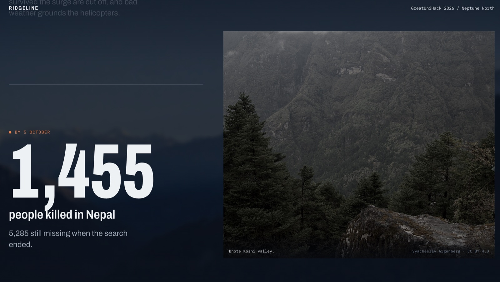
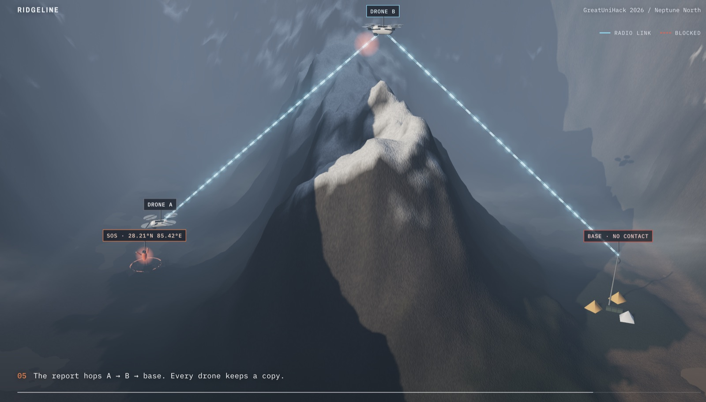
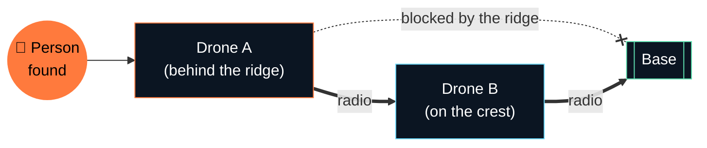
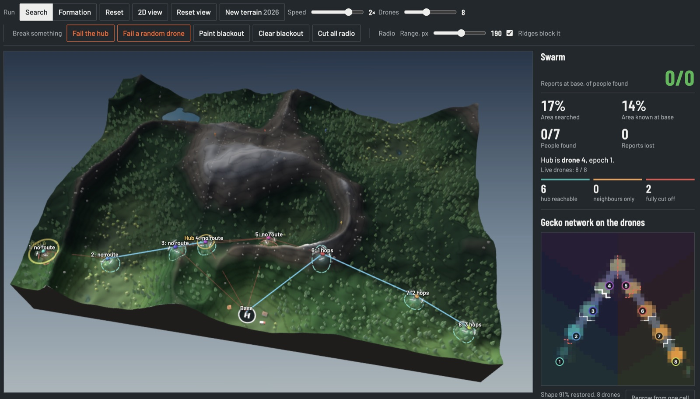
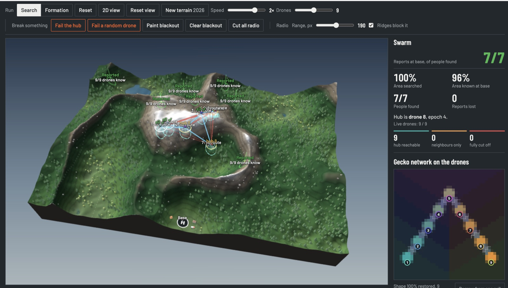
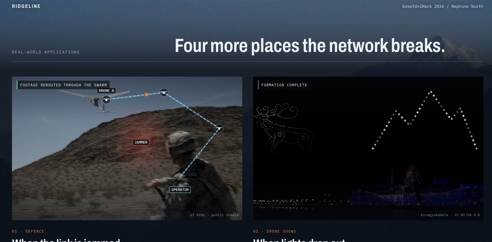

<div align="center">


# Ridgeline

**A rescue drone swarm that keeps searching when the mountain cuts the signal.**

No drone waits for orders. No find is held by one drone alone. Lose the hub, lose the radio: the search goes on.

[](#)
[](#)
[](#install)
[](#run-it)

[The problem](#the-problem) · [How it works](#how-it-works) · [Run it](#run-it) · [Phones as drones](#phones-as-drones) · [The network](#the-self-repairing-network) · [Limits](#honest-limits)

</div>

---

## The problem

On **26 August 2026**, rock and ice broke off Langtang Lirung in Nepal and dammed the river below. When the dam burst, the flood ran down the Bhote Koshi and Trishuli valleys through Rasuwa. Phone towers went down within the hour. People who survived the surge were cut off, and bad weather kept the helicopters away. **1,455 people died in Nepal; 5,285 were still missing when the search ended.**

Drones can reach a valley like that in minutes. But the valley's problem becomes theirs: **mountains block radio**. A drone that flies behind a ridge goes silent, and if the drone coordinating the others fails, a normal swarm stops and waits.

Ridgeline is built for exactly that moment.

<sub>Sources: Wikipedia, *2026 Nepal–Tibet floods*; Al Jazeera, 27 Aug 2026; Kathmandu Post, 26 Aug 2026.</sub>



## How it works



<p align="center"><sub>The presentation's 3D scene: the ridge blocks drone A's radio, so drone B climbs to the crest and relays the report to base.</sub></p>



Every drone runs the same small set of rules on **its own copy** of what the swarm knows. Nothing depends on a leader.

| | Idea | What it means in the air |
|---|---|---|
| 🧠 | **Shared swarm memory** | Each drone keeps a copy of every report, the ground searched and who is still flying. At every contact it merges copies with its neighbours. A find that reaches one other drone survives losing the drone that made it. |
| 👑 | **No leader to lose** | If the hub goes quiet for about 5 s, the lowest-numbered drone that can still hear others takes over with a higher *epoch*. If the old hub returns, it steps down. Search and reports never depended on it, so losing it costs nothing. |
| 🧭 | **Decides alone** | Each drone searches a fixed home strip, worked out from the launch list, so no message is needed to agree it. When the strip is done, it helps with ground it believes is unsearched. |
| 📦 | **Data mule** | A drone holding a report with no radio route to base flies the report home itself. Other holders wait their turn, so the report still gets home if the first carrier is lost. |
| 🦎 | **A formation that heals** | A neural cellular automaton, based on [Google's self-repairing gecko](https://distill.pub/2020/growing-ca/), is computed *by the drones between them*: each runs it on its own patch and swaps edge cells by radio. Fail a drone and its neighbours regrow its part. |

A full message is up to about 1.4 KB for 15 drones with 7 reports. The full design is in [`docs/hub-recovery-plan.md`](docs/hub-recovery-plan.md).

## Three ways to see it

| | What | Where |
|---|---|---|
| 🎬 | **Presentation site**: the story in four screens. Intro over a real photo of the Langtang range, the 26 August timeline with real footage, a scroll-driven 3D relay rescue, then real-world applications. | [`site/`](site) · `localhost:8080/site/` |
| 🛰️ | **Live simulation**: launch 3–15 drones, fail the hub or any drone, paint a radio blackout, cut all radio, and watch the search graph. Switch between **2D and 3D** on the same running simulation. | [`demo/`](demo) · `localhost:8080/demo/` |
| 📱 | **Phones as drones**: up to three iPhones fly real drones in the swarm. Turn on aeroplane mode and the phone keeps searching alone; turn it off and what it found spreads through the swarm. | [`demo/phone.html`](demo/phone.html) · [design doc](docs/designs/phone-drones.md) |

The search graph compares the run you're watching with two hidden runs on the same terrain: one with radio on and nothing failed, one with no radio at all.

<table>
<tr>
<td width="50%"></td>
<td width="50%"></td>
</tr>
<tr>
<td><sub><b>Mid-search.</b> Drones behind the ridge have no route to base but keep searching; 2 are fully cut off.</sub></td>
<td><sub><b>Done.</b> All 7 people reported to base, 100% searched, and the gecko network panel shows the formation restored.</sub></td>
</tr>
</table>

## Run it

### Install

```bash
npm install
```

This installs the one dependency, `qrcode-generator`, which the phone helper uses. The project needs **Node 20 or later**. `npm test` and `npm run phones` run it for you. If the install fails, `npm test` stops, but `npm run phones` carries on and the helper starts without the QR code: `/qr.svg` returns 503, and phones use the address the helper prints. The demo pages themselves need nothing installed.

### Start

Serve the repo root, because ES modules don't load from `file://`:

```bash
npm run demo
```

This runs `python3 serve.py` (with caching off). Then open:

- **http://localhost:8080/site/**: the presentation
- **http://localhost:8080/demo/**: the simulation. Use the **3D view / 2D view** button to switch; `?view=3d` (or `/demo3d/`) opens it straight in 3D, and the page remembers the last view you used.

> [!NOTE]
> The presentation site loads its photos, footage and three.js from the web, so it needs an internet connection. The demo's three.js is vendored and works offline.

## Phones as drones

The separate devices, the Wi-Fi links between them and aeroplane mode are **real**. Each phone runs the same `recovery/swarm-recovery.js` as the laptop, and the devices talk directly to each other over WebRTC data channels. The flight, sensors, terrain, people and drone radio range are simulated on each phone.

**Quick start**

1. Put the laptop and the phones on the same Wi-Fi, and set **Auto-Lock to Never** on each phone (Settings > Display & Brightness).
2. Run `npm run phones` and open **http://localhost:8080/** on the laptop only. This is the big screen.
3. Choose the number of drones (15 by default), then phones scan the QR code on the big screen.
4. Press **Launch**. It stays off until a phone has joined.
5. Wait about 35 seconds for the phone drones to reach their strips, then turn on **aeroplane mode** on a phone.

<details>
<summary><b>Full phone-mode reference</b>: statuses, map colours, reloads, troubleshooting</summary>

<br>

Up to three iPhones fly drones 1, 2 and 3, and the laptop flies the rest. Don't type the localhost address on a phone. Before launch, the Fail buttons are refused. In a narrow window the Phones panel comes first, above the map.

Yellow means not connected, on both screens. After launch, a drone on the big screen gets a pulsing yellow halo and a tag such as `2 NOT CONNECTED` at its last known position. Before launch, a phone that isn't linked only gets the halo, and the Phones panel names it.

Phone drones show in both views, 2D and 3D. Keep the big screen's window in front: if it's hidden it stops running, and the swarm wrongly writes off the phones.

The status box on a phone shows one of these once the drone is flying:

| Status | Meaning |
|---|---|
| CONNECTED (green) | Linked to the big screen or another phone |
| CONNECTING (yellow) | This page has just loaded and isn't linked yet |
| NOT CONNECTED (yellow) | No link to any device. The drone carries on and counts the cells it explores alone |
| RADIO OFF (yellow) | The "Radio off" button is on. It's a button, not a real outage |
| BIG SCREEN LOST (yellow) | Still linked to another phone, but not to the laptop |

The line below it is about simulated radio, so a connected phone can still read "Hears nobody over radio". It says "Hears N drones", with "and base" if base is in range, or "Hears base", or "Radio cut from the big screen". It ends with the hub, as "Hub: drone N" or "This drone is the hub".

The phone's map shows what that drone knows:

| Colour | Meaning |
|---|---|
| Teal | Searched by this drone |
| Yellow | First explored by this drone while offline |
| Blue | Learned from other drones |
| Dark | Not explored |
| Dashed white outline | This drone's strip |
| Red | Radio blackout |

A reloaded phone carries on with its drone. The page saves the drone to `localStorage` every 2 seconds, per mission and drone.

Reloading or reopening the big screen during a run rejoins that run, if it was launched in the last 20 minutes. The page replays the laptop's drones to the shared clock from the same seed, and the phones then bring back what they know. Anything done on the laptop is lost: failed drones fly again, and blackouts, a radio cut and range changes are gone, on the phones too. A second big screen tab is refused while the first is running. To start a new run, use Reset, the Drones slider, New terrain, or "Start a new run here". Phones keep their drones into the next run and reload by themselves. Before launch, a phone page that stops polling for 10 seconds gives up its drone, and reloads itself to join again when it returns.

Keep the phone page open throughout, because a hidden phone page stops. Keep the big screen in front too: if it's hidden it stops drawing, and a timer steps it only about once a second.

The helper serves the pages, starts the mission, shares the clock and introduces devices. Positions and findings never pass through it. Only the laptop can start or launch a mission. Phones need the helper to join, to reload and to reconnect after an outage, but linked phones keep talking without it.

If the QR code shows the wrong address, set it yourself:

```bash
PHONE_HOST=192.168.1.20 npm run phones
```

To read what each phone logged during a rehearsal, start the helper with logs on and open http://localhost:8080/report:

```bash
PHONE_LOGS=1 npm run phones
```

</details>

## The self-repairing network

The formation network is a 40 × 40, 16-channel Growing Neural Cellular Automaton trained in *Regenerating* mode on the swarm's V formation. Its weights export to JSON and run in plain JavaScript ([`recovery/nca-runtime.js`](recovery/nca-runtime.js)). The grid is split between the live drones: each computes only the cells nearest its place in the V and gets the border cells it needs from its neighbours by radio. Split this way with everyone in reach, it gives exactly the same result as running the network in one place (tested).

Retrain it:

```bash
python3 -m venv nca/.venv && nca/.venv/bin/pip install torch numpy
nca/.venv/bin/python nca/train_nca.py                # ~16 min on an M2
node nca/eval_regrow.mjs                             # erase each drone slot, check it regrows
```

The network is based on Google's Growing Neural Cellular Automata (Apache-2.0). The original code isn't committed here; clone it with:

```bash
git clone --depth 1 https://github.com/google-research/self-organising-systems.git vendor/self-organising-systems
```

## Project structure

```text
.
├── recovery/                 # the swarm brain: plain ES modules, no dependencies
│   ├── swarm-recovery.js     #   shared state, merge, hub takeover, hop counts, strips, formation slots
│   ├── nca-runtime.js        #   runs the trained network in the browser
│   └── models/               #   trained weights (formation-nca.json)
├── demo/                     # the live simulation
│   ├── drone.js              #   what one drone does
│   ├── sim.js                #   the simulation, no DOM (fixed time steps, seeded)
│   ├── demo.js               #   draws it, and switches to the 3D view
│   ├── messages.js           #   animates news moving between drones
│   ├── phone.html            #   turns an iPhone into a drone
│   ├── phone-drone.js        #   flies the phone's drone
│   ├── net.js                #   direct device-to-device links (WebRTC)
│   ├── phone-link.js         #   the big screen's side of phone mode
│   ├── mission.js            #   what every device must agree on
│   └── phone-server.mjs      #   the helper: pages, clock, introductions
├── demo3d/                   # 3D scene (Three.js vendored, MIT); opens the demo in 3D
├── site/                     # the presentation website
├── nca/                      # training and evaluation for the network (PyTorch)
├── docs/                     # design docs: hub recovery, phone drones, presentation brief
└── serve.py                  # static server with caching off
```

## Tests

```bash
npm test
```

Covers swarm merging, hub takeover, the network runtime, the simulation, device links, the phone helper and the phone flow. `demo/test/pages.test.mjs` checks that every page script parses; no test runs the pages in a browser.

## Real-world applications

The same idea works anywhere a network can fail. The presentation site shows each one over a real photo:



| | Where | Today | With the swarm |
|---|---|---|---|
| 🛡️ | **Defence** | A jammed drone loses its operator and its footage | Drones outside the jammed zone pass its data home, hop by hop |
| ✨ | **Drone shows** | A failed drone leaves a hole in the picture | Neighbours close the gap themselves |
| 🚴 | **Sport** | Mountain-stage TV goes through relay helicopters and planes | A drone chain over the climb carries the feed |
| 🔦 | **Blackouts** | The EU, UK and France tell households to cope alone for 72 hours | Drones carry calls for help from phones to the crews |

## Honest limits

We'd rather you hear these from us:

- **It's a simulation.** Drones move in 2D over a height map, and battery and payload aren't modelled. Phone mode makes the devices, links and outages real; the flight and sensors are still simulated.
- **A report held by one drone can die with it.** Replication only works after contact. The person can be found again, and *Reports lost* counts this case.
- **False takeovers happen.** With ridges blocking radio and nothing failed, a normal demo run has about 3–5 hub takeovers. Phone mode has more: one full three-phone rehearsal at the slower speed had 13. The search doesn't notice, but it's visible.
- **Comms barely change how fast ground is searched**, because strips are fixed. What comms decide is *when base finds out*.
- **Messages aren't authenticated.** A forged epoch or `delivered` flag would be believed.
- **The network draws the formation; it doesn't fly it.** Where each drone flies comes from the shared state.
- **Hop counts top out at 16**, so a longer chain would read as no route.

## Team

Built at GreatUniHack 2026 for the Neptune North challenge.

| | Part |
|---|---|
| **Vitalii** | Hub recovery, shared swarm memory, the self-repairing network, the simulation |
| **Dima** | Phones as drones: device links, the helper, phone mode |
| **Alisa** | Presentation website and story |

## Credits

- Growing Neural Cellular Automata: Mordvintsev et al., [Distill 2020](https://distill.pub/2020/growing-ca/), Google (Apache-2.0)
- [Three.js](https://threejs.org) (MIT)
- Photos and footage on the presentation site: Wikimedia Commons contributors, credited on each image (public domain, CC BY and CC BY-SA)
